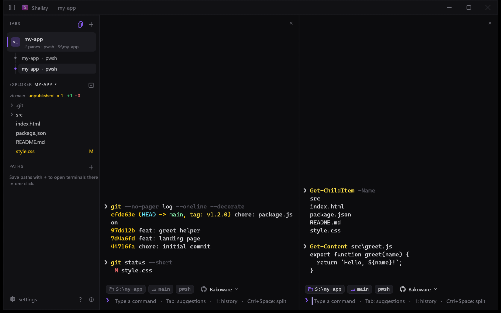
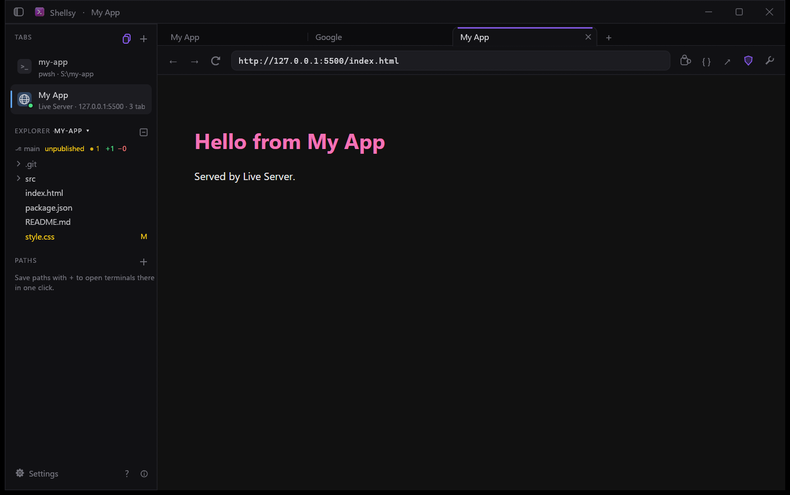
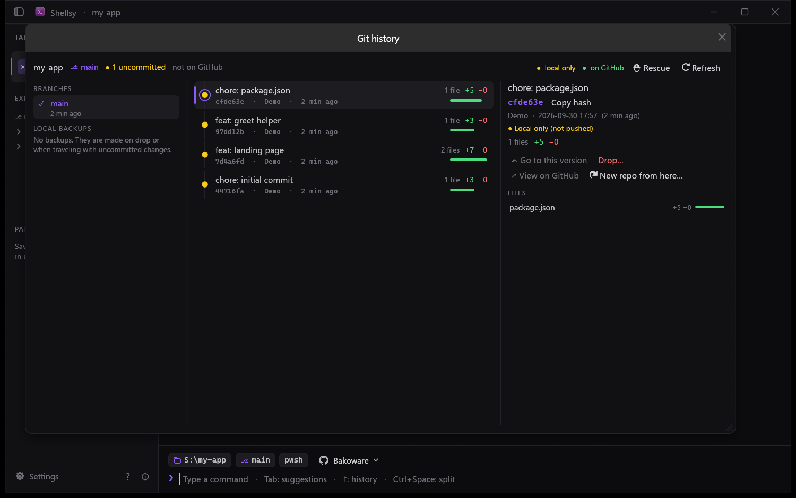
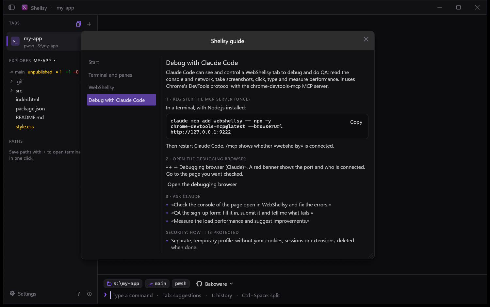
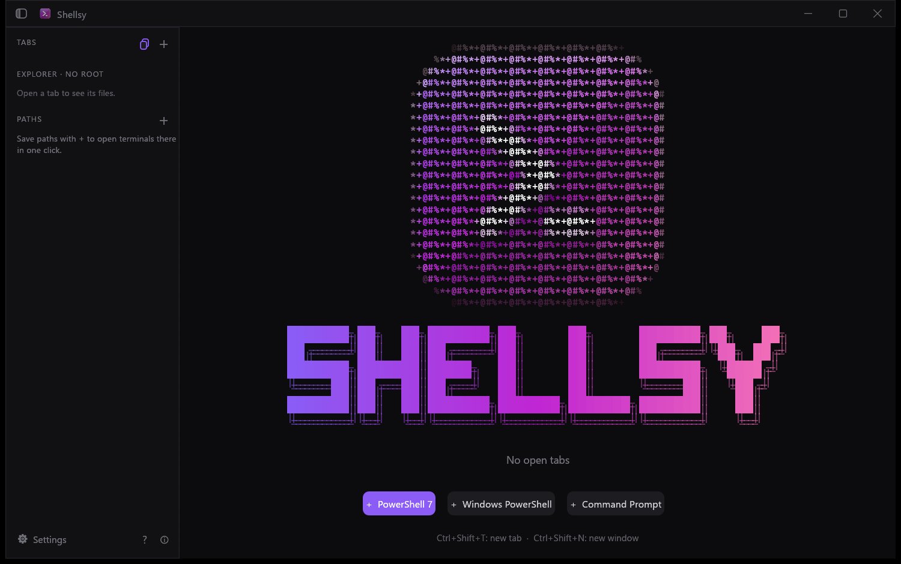

# Shellsy

**A lightweight terminal for Windows, made in Rust.**
Tabs, split panes, a built-in browser, git history and Claude Code debugging — in one fast window.

[**Download the latest installer**](https://github.com/Bakoware/Shellsy-Releases/releases/latest) · Windows 10/11 (64-bit) · Free

This repository only hosts the installers and the license. Shellsy's source code is not public.

## What you get

**Terminal**
- PowerShell 7, Windows PowerShell and cmd in tabs, with **split panes** (Ctrl+Space, Ctrl+Shift+E).
- A typing line with **suggestions, history and ghost completion**; while a program runs (Claude CLI, vim, installers), keys go straight to it.
- Folder, git branch and GitHub account chips on every pane; a file **explorer** with git status.
- **Sessions are remembered**: close Shellsy and your tabs, folders and output come back.

**WebShellsy — the built-in browser**
- **Browser tabs inside each tab**, history (Ctrl+H) and a tools menu to clear browsing data.
- **Built-in shield** that blocks ads and trackers, YouTube included.
- **Live Server**: serve a folder and reload on save.

**Git, without leaving the terminal**
- A visual **git history**: browse commits, travel to a version, drop a commit while keeping the code, local backups and a rescue window.
- **Git macros**: push, create a GitHub repository or your own command chains in one click.

**Debug with Claude Code**
- Open a **debugging browser** and let Claude Code inspect the console and network, take screenshots and test your pages through an MCP server — in a separate, temporary profile, only on `127.0.0.1`, and closed automatically when you are done.
- A built-in **guide** (the «?» button) explains every step, with the MCP command ready to copy.

## Install

1. Download **`Shellsy_Setup_v<version>.exe`** from the [latest release](https://github.com/Bakoware/Shellsy-Releases/releases/latest).
2. Run it. It installs for your user only — **no administrator rights needed**.
3. Read the notice, accept the [license](LICENSE.md), and follow the wizard.

The installer checks what is missing and **asks before installing anything**:
- **Microsoft Edge WebView2 Runtime** (for WebShellsy) — usually already on Windows 11.
- Optional: **Git**, **GitHub CLI**, **PowerShell 7** and **Node.js** (for Claude Code debugging), through `winget`.

Shellsy starts on its welcome screen the first time. To keep it at hand, right-click its taskbar icon → **Pin to taskbar**.

### Updating

Shellsy does not update itself yet. Download the newer installer and run it: it closes Shellsy, **removes the previous version without touching your data** (settings, sessions, history and WebShellsy sign-ins) and installs the new one.

### Requirements

- Windows 10 version 1809 or newer, or Windows 11 — 64-bit.
- A graphics driver with OpenGL support (any normal PC).

## ⚠️ In development — use at your own risk

Shellsy is under active development and some features are still being tested. Its **git and GitHub features can delete or rewrite commits, branches, tags or remote repositories**: review every operation before confirming it and keep your own backups. Shellsy sends **no usage data**; your settings stay on your computer (`%APPDATA%\Shellsy`).

## License

**Shellsy is free, proprietary software by Bakoware.** You may install and use it for free. You may **not** sell it, modify it, redistribute it or reverse engineer it, and its source code is not distributed. The name **Shellsy**, its logo and its visual identity belong to Bakoware; future versions may be offered under different terms.

- [LICENSE.md](LICENSE.md) — Spanish, the governing version.
- [LICENSE.en.md](LICENSE.en.md) — English courtesy translation.
- [NOTICE.md](NOTICE.md) — third-party components and their licenses ([full texts](licenses/THIRD-PARTY-LICENSES.txt)).

---

<b>Español</b>

**Shellsy** es una terminal ligera para Windows, hecha en Rust: pestañas, paneles divididos, el navegador WebShellsy (con pestañas, historial y escudo contra anuncios), historial visual de git, macros y depuración de páginas con Claude Code.

- **Instalar:** descarga el instalador de la [última versión](https://github.com/Bakoware/Shellsy-Releases/releases/latest), ejecútalo (no pide administrador), acepta la licencia y sigue el asistente. Revisa lo que falta y pide permiso antes de instalar algo.
- **Actualizar:** instala el instalador de la versión nueva; quita la anterior sin borrar tus datos.
- **En desarrollo:** úsalo bajo tu propio riesgo. Las funciones de git pueden borrar o reescribir commits, ramas, etiquetas o repositorios remotos.
- **Licencia:** gratuito y propietario, de Bakoware. Prohibido venderlo, modificarlo, redistribuirlo o hacerle ingeniería inversa. La [licencia en español](LICENSE.md) es la que rige.

© 2026 Bakoware. Shellsy and WebShellsy, their name, logo and image belong to Bakoware.

